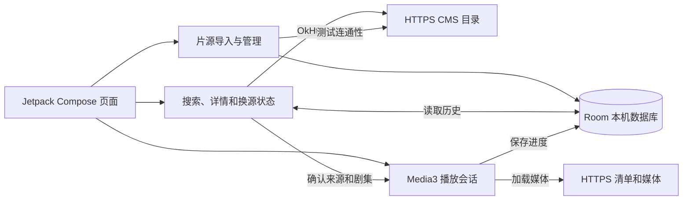
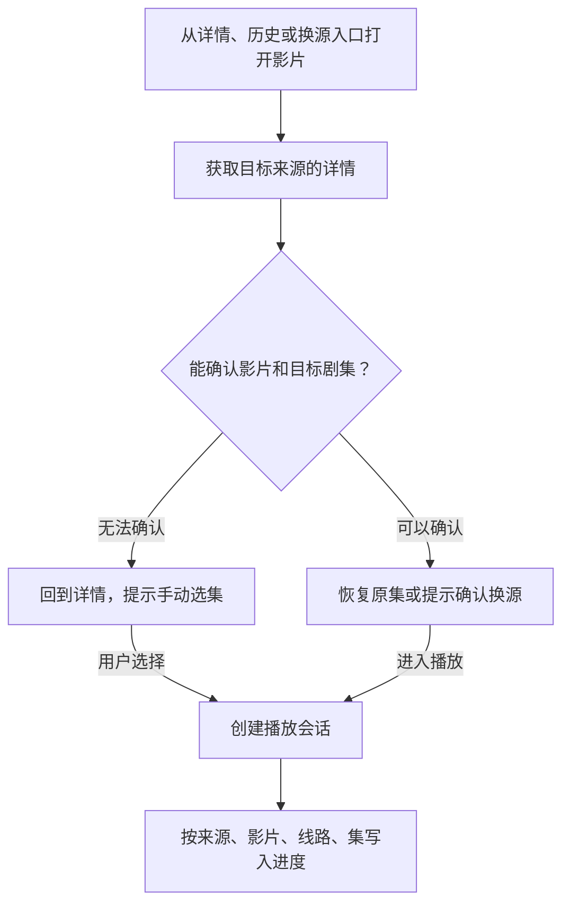

# LibreTV Android

LibreTV Android 是面向 Android 手机和平板的原生点播客户端。应用直接访问用户配置的 HTTPS CMS 点播目录与媒体地址，支持多源搜索、选集、播放及本机续播。构建和调试可以在另一台电脑上独立完成。安装后，播放所需网络由 Android 设备提供。

当前构建配置为 **0.6.2（versionCode 14）**。`main` 包含该演练候选之后的三项修订。版本变动和验收状态见[更新日志](updatelog.md)。

原生客户端以 LibreTV 网页版 v2.21.2 的点播和片源行为为参考。[上游项目](https://github.com/LibreSpark/LibreTV/tree/v2.21.2) · [上游许可证](https://github.com/LibreSpark/LibreTV/blob/v2.21.2/LICENSE)

[快速开始](#快速开始) · [点播源与首次试用](#点播源与首次试用) · [功能与边界](#功能与边界) · [工作原理](#工作原理) · [项目结构](#项目结构) · [测试与故障定位](#测试与故障定位) · [签名与覆盖升级](#签名与覆盖升级)

## 快速开始

### 开发环境

| 项目 | 版本或条件 |
|---|---|
| Android Studio | 可运行 AGP 9.0.1 的版本。既有 macOS 验证环境为 Android Studio Rabbit 2 2026.2.2 Patch 2 |
| Gradle JVM | 推荐 Studio 内置 JBR 25，既有构建使用 25.0.4。Java 源码和目标字节码为 Java 17 |
| 构建 | Gradle Wrapper 9.1.0，AGP 9.0.1，内置 Kotlin 2.2.10，Compose 编译器插件 2.2.10，KSP 2.3.5 |
| Android SDK | SDK Platform 36、Build Tools 36.0.0、Platform-Tools。模拟器运行另需 Android Emulator 与对应架构的系统镜像 |
| 应用兼容范围 | 最低 Android 8.0（API 26），目标 API 35，编译 API 36 |
| 主要依赖 | Compose BOM 2025.10.01、Material 3、Room 2.8.4、Media3 1.8.0、OkHttp 4.12.0、Gson 2.11.0 |
| 首次构建联网 | Gradle 分发站点、Google Maven、Maven Central 和 Gradle Plugin Portal。首次安装 SDK 还需连接 SDK 下载站点 |
| 附加工具 | Git 用于克隆和版本开发。Python 3.9 或更新版本用于可选的发布签名验证与辅助检查 |

工程 Wrapper 固定版本和发行包摘要。依赖版本、SDK 和包版本分别由工程文件维护。[Wrapper](gradle/wrapper/gradle-wrapper.properties) · [版本目录](gradle/libs.versions.toml) · [应用构建设置](app/build.gradle.kts)

### 克隆并在 Android Studio 运行

```sh
git clone https://github.com/caozichen/androidTV.git
cd androidTV
```

1. 在 Android Studio 选 **File → Open**，打开包含 `settings.gradle.kts` 的工程根目录。
2. 打开 **SDK Manager**，安装 API 36、Build Tools 36.0.0 和 Platform-Tools。Gradle 设置选择项目的 **Wrapper**，Gradle JDK 选择 **Embedded JDK / jbr-25**，等待 Gradle Sync 完成。
3. 在 **Device Manager** 新建一个 API 36 手机 AVD。系统镜像架构选择宿主机支持的架构，例如 Apple Silicon 上的 ARM64。也可以连接已开启 USB 调试、授权本机的 Android 8.0 或以上真机。
4. 在 **Build Variants** 选择 `debug`，选中 `app` 运行。桌面图标显示「LibreTV 调试版」。Gradle 会使用本机调试密钥，正式签名材料只在构建签名发行包时使用。
5. 首页点「环境检查」确认 Room 与 Media3 初始化，返回首页后点「播放对照样片」验证离线实际播放。

### 从终端构建

将 `JAVA_HOME` 设为 Studio JBR 目录，将 `ANDROID_HOME` 设为 SDK Manager 显示的 SDK 路径。以下默认路径根据安装方式调整。SDK 也可以由 Android Studio 在本机创建 `local.properties` 后定位。

| 平台 | JBR 路径示例 | SDK 路径示例 |
|---|---|---|
| macOS | `/Applications/Android Studio.app/Contents/jbr/Contents/Home` | `$HOME/Library/Android/sdk` |
| Windows | `C:\Program Files\Android\Android Studio\jbr` | `%LOCALAPPDATA%\Android\Sdk` |
| Linux | `/opt/android-studio/jbr` | `$HOME/Android/Sdk` |

**macOS／Linux**，以 macOS 默认路径为例。Linux 按上表替换两个目录。

```sh
export JAVA_HOME='/Applications/Android Studio.app/Contents/jbr/Contents/Home'
export ANDROID_HOME="$HOME/Library/Android/sdk"
export PATH="$ANDROID_HOME/platform-tools:$PATH"

./gradlew --version
./gradlew --max-workers=1 --no-parallel :app:testDebugUnitTest :app:lintDebug :app:assembleDebug
adb devices -l
```

**Windows PowerShell**

```powershell
$env:JAVA_HOME = 'C:\Program Files\Android\Android Studio\jbr'
$env:ANDROID_HOME = Join-Path $env:LOCALAPPDATA 'Android\Sdk'
$env:Path = "$env:ANDROID_HOME\platform-tools;$env:Path"

.\gradlew.bat --version
.\gradlew.bat --max-workers=1 --no-parallel :app:testDebugUnitTest :app:lintDebug :app:assembleDebug
adb devices -l
```

调试 APK 位于 `app/build/outputs/apk/debug/app-debug.apk`。替换下列示例中的设备号后，可在各平台终端复核安装和冷启动。

```sh
adb -s emulator-5554 install -r app/build/outputs/apk/debug/app-debug.apk
adb -s emulator-5554 shell am force-stop dev.libretv.android.debug
adb -s emulator-5554 shell am start -W -n dev.libretv.android.debug/dev.libretv.android.MainActivity
```

启动成功时可以看到搜索首页，`am start -W` 同时给出 `Status: ok` 和冷启动耗时。首次构建先联网下载依赖。缓存就绪后，可用 `--offline` 验证离线重建。构建资源紧张的机器可串行运行构建和模拟器，一次仅保留一个工作负载。

## 点播源与首次试用

新装后从空片源列表开始。首页点「添加点播源」或「点播源管理」，可手动输入名称和 HTTPS CMS 接口，或选「从文件导入」。导入支持 UTF-8 JSON 对象与裸数组，文件上限 1 MiB，来源总数上限 100。`detail` 是可选的详情根地址。`isAdult` 接受布尔值，标记为成人的来源默认停用。普通来源默认启用，重导同一端点保留已有名称和启用状态。

```json
{
  "sources": [
    {
      "name": "我的点播源",
      "url": "https://catalog.example.org/api.php/provide/vod/",
      "isAdult": false
    }
  ]
}
```

1. 将仓库里的脱敏样例保存到设备「下载」目录，打开导入预览。首次应显示可导入 1、重复 1、无效 0、直播跳过 1。点取消可返回原列表，点确认写入选中的有效来源。错误样例的三个点播条目均应列为无效。[脱敏样例](samples/source-list.json) · [错误样例](samples/source-list-invalid.json)
2. 样例域名仅用于验证导入。实际播放时添加自己有权使用、设备可以访问的来源。在来源行点「测试」，核对 CMS 可访问性和最近检查结果。
3. 返回首页搜索片名，例如「航拍中国」。点击影片详情再选集，核对来源、集名、首帧和时间轴。暂停后记下位置，退出播放器并从「最近观看」重新打开，验证续播。
4. 首页的「播放对照样片」使用 24 秒包内素材。素材含自生成动态图、440 Hz 测试音与 6 个 HLS 分片，适合排查设备解码和音频输出。[样片目录](app/src/main/assets/control/)

## 功能与边界

| 功能 | 当前行为 |
|---|---|
| 点播源管理 | 从文件预览并确认导入，支持手动添加、测试、改名、启停及删除确认。同一 HTTPS 端点规范化后按稳定标识保存 |
| 多源搜索 | 逐源展示结果，慢源等待期间可打开已返回的影片。最多 4 个并发请求，每源最多 5 页，全批共享 10 秒搜索截止时间。「各源状态」支持单源重试。搜索缓存约 60 秒，「重新搜索」可绕过缓存 |
| 内容过滤 | 默认过滤标记为成人的来源及对应分类，可在首页「搜索片源」调整。最近观看采用同一过滤设置 |
| 影片详情和换源 | 详情成功获取后缓存 60 秒。换源刷新候选详情并提示确认。影片身份与剧集标签匹配明确时建议对应集，缺集、预告、重名或身份不明确时手动选集 |
| 播放控制 | 支持 HLS（含无后缀清单）、设备可解码的 MP4、进度拖动、暂停、前后集和选集。横屏可进入全屏，点画面显示操作控件。返回先离开全屏，再回原详情。退到桌面暂停，回到原任务后可点播放 |
| 本机历史和续播 | 按来源、影片、线路、剧集分别保存。刷新详情后以稳定标识恢复，身份无法确认时进入详情手选。已看完的集可重播，有下一集时可继续观看 |
| 历史管理与故障恢复 | 首页可分批展开历史，删除指定来源下的整部影片历史。详情可清除指定线路的一集。停用、删除后重加同一端点可找回已有记录。地址失效时尝试为同集刷新一次，恢复时从最后有效位置继续 |

当前产品范围是原生 HTTPS 点播。直播、离线下载、投屏、跨设备历史同步与电视遥控器适配留待后续开发。播放成功取决于来源可达性、节目有效期与设备的音视频编解码能力。Android 运行时直接访问配置的目录与媒体服务。

## 工作原理

### 页面、数据与播放



### 续播与换源的确认流程



## 项目结构

```text
.
├── app/
│   ├── build.gradle.kts                # Android 模块、SDK、包名、版本和签名策略
│   ├── schemas/                       # Room 各版 schema，供迁移和回归使用
│   ├── src/main/
│   │   ├── AndroidManifest.xml        # 权限、Activity、备份和 HTTPS 配置
│   │   ├── assets/control/            # 本地 HLS 样片
│   │   ├── java/dev/libretv/android/  # Kotlin 业务、Compose 页面与 Media3 会话
│   │   └── res/                       # 应用资源
│   └── src/test/                      # JVM 测试及 CMS JSON 固定样例
├── gradle/                            # 依赖版本目录与 Wrapper
├── samples/                           # 片源导入的脱敏样例及错误样例
├── tools/                             # 发布签名和验收辅助工具
├── gradlew / gradlew.bat              # Unix / Windows 构建入口
└── updatelog.md                       # 未发布变更、版本摘要和验收状态
```

| 修改方向 | 从这些文件入手 |
|---|---|
| 应用与页面入口 | [MainActivity.kt](app/src/main/java/dev/libretv/android/MainActivity.kt) · [CatalogScreen.kt](app/src/main/java/dev/libretv/android/CatalogScreen.kt) · [RecentWatches.kt](app/src/main/java/dev/libretv/android/RecentWatches.kt) |
| 片源管理、导入和持久化 | [SourceManagerState.kt](app/src/main/java/dev/libretv/android/SourceManagerState.kt) · [SourceImport.kt](app/src/main/java/dev/libretv/android/SourceImport.kt) · [SourceStore.kt](app/src/main/java/dev/libretv/android/SourceStore.kt) |
| 请求、解析、并发和换源 | [Catalog.kt](app/src/main/java/dev/libretv/android/Catalog.kt) · [CatalogSearch.kt](app/src/main/java/dev/libretv/android/CatalogSearch.kt) · [CatalogRecovery.kt](app/src/main/java/dev/libretv/android/CatalogRecovery.kt) · [SwitchSource.kt](app/src/main/java/dev/libretv/android/SwitchSource.kt) |
| 播放器界面、媒体识别与会话 | [PlaybackScreen.kt](app/src/main/java/dev/libretv/android/PlaybackScreen.kt) · [MediaTypeResolver.kt](app/src/main/java/dev/libretv/android/MediaTypeResolver.kt) · [PlaybackSession.kt](app/src/main/java/dev/libretv/android/PlaybackSession.kt) |
| 进度、续播身份和数据库迁移 | [HistoryStore.kt](app/src/main/java/dev/libretv/android/HistoryStore.kt) · [ResumeEpisode.kt](app/src/main/java/dev/libretv/android/ResumeEpisode.kt) · [Room schema](app/schemas/) |

## 测试与故障定位

| 验证层 | 怎样检查 |
|---|---|
| 本地 JVM | 运行 `:app:testDebugUnitTest`。覆盖 CMS 地址与响应解析、片源导入、分页和搜索超时、影片身份、剧集标签、续播匹配、历史会话等。报告在 `app/build/reports/tests/testDebugUnitTest/index.html` |
| 静态检查 | 运行 `:app:lintDebug`。报告在 `app/build/reports/lint-results-debug.html` |
| 装包与离线播放 | 「环境检查」在内存数据库写入并读回测试记录，同时构造并释放 Media3 HLS 媒体源。「播放对照样片」另外验证真实首帧、音轨和播放推进 |
| 线上点播 | 手动记录片源、影片、线路、集号，分别检查目录响应、详情、媒体清单、分片和播放效果。更换设备或网络时使用同一组来源和节目 |
| 续播与升级 | 设置两集不同位置，并为两个来源保留不同开关。冷启或用同包同签名高版本覆盖后，分别从「最近观看」和搜索详情进入，读取真实集名和起播位置 |

播放器诊断区显示清单、媒体加载、首帧、位置和音轨状态。终端可用 `adb logcat -s LibreTVPlayback:I` 查看播放事件。`audio_output advancing=true` 表明输出时钟推进，真机试听用于确认扬声器或耳机实际有声。

升级验收可以从设备读取「点播源管理」页面的 UI XML，按来源名验证实际启用状态。在保存前后两份 XML 时，为它们选用不同的本地文件名，并替换设备号、来源名和状态。

```sh
adb -s emulator-5554 shell uiautomator dump /sdcard/source-switches.xml
adb -s emulator-5554 pull /sdcard/source-switches.xml ./source-switches.xml
python3 tools/check_source_switches.py source-switches.xml "示例片库=on" "备用片库=off"
```

测试只使用脱敏来源。UI XML 保存在设备和本机指定目录中，验收结束后可清理。[开关核验工具](tools/check_source_switches.py)

| 现象 | 优先检查 |
|---|---|
| Gradle 无法同步或找不到 Android SDK | 核对 `./gradlew --version` 的 JVM、Studio 的 Gradle JDK、SDK Manager 的 Platform 36 与 Build Tools 36.0.0。首次构建检查依赖仓库访问 |
| `adb` 列表为空或存在多台设备 | 打开模拟器，或连接并授权真机。用 `adb devices -l` 获取设备号，并在安装和日志命令中指定 `-s` |
| 调试包覆盖时提示签名冲突 | 检查该手机上的包名和证书。换机往往会生成另一把调试密钥。需要保留原数据时应使用原签名进行覆盖，并先确认备份方式 |
| 样片可播，线上某源失败 | 先在来源行点「测试」，再看搜索、详情及播放诊断的失败阶段。检查设备网络、HTTPS 目录可达性和该节目的实际媒体地址 |

## 签名与覆盖升级

| 桌面名称 | 包名 | 用途 |
|---|---|---|
| LibreTV 调试版 | `dev.libretv.android.debug` | IDE 和本地开发，使用调试证书 |
| LibreTV 演练版 | `dev.libretv.android.rehearsal` | 带数据升级和签名恢复演练，使用独立演练证书 |
| LibreTV | `dev.libretv.android` | 使用正式签名的发布构建 |

三个包可以并装，各自拥有独立的数据库和设置。保留数据的覆盖升级需要相同包名、相同签名证书和更高 `versionCode`。正式签名、演练签名之间的升级记录应分别维护。

### 首次生成并保管签名材料

1. 在 Android Studio 的 **Build → Generate Signed App Bundle or APK → APK → Create new** 创建密钥库。密钥库、配置和备份放在工程外的私人目录。长期使用时设置独立强密码和足够长期的有效期。
2. 使用 `keytool -list -v -keystore "/绝对路径/密钥库" -alias "别名"`，确认是 `PrivateKeyEntry` 并独立记录公开证书 SHA-256。制作加密备份，恢复到另一私人目录后实际试签。
3. 创建仓库外的 UTF-8 `signing.properties`。macOS／Linux 可将私人目录权限设为 `700`，配置与密钥库权限设为 `600`。Windows 可在属性文件中使用正斜线写绝对路径或把反斜线写两次。

```properties
purpose=release
storeFile=/密钥库的绝对路径
keyAlias=自己的别名
storePassword=库密码
keyPassword=密钥密码
```

### 构建并核验签名 APK

先完成联网构建并运行 release Lint，以填充发布任务所需的 Gradle 缓存。确认将交付的版本号，在工程根目录运行。下例使用当前工程版本号和 macOS／Linux shell。把路径及证书摘要换成实际值，选择尚未存在的交付文件名。

```sh
export LIBRETV_SIGNING_FILE="$HOME/.config/libretv-android/release/signing.properties"
export LIBRETV_EXPECTED_CERT_SHA256='填入独立登记的正式证书 SHA-256'
python3 tools/release.py build release \
  --cert-sha256 "$LIBRETV_EXPECTED_CERT_SHA256" --version-name 0.6.2 --version-code 14 \
  --output "$HOME/Downloads/LibreTV-0.6.2-release.apk"
```

演练使用 `purpose=rehearsal`、`build rehearsal`、独立演练证书与新的 APK 文件名。交付工具离线执行 clean、单测、release Lint 和 APK 打包，验证候选包的证书、包名、版本后输出 APK 和 SHA-256。交付路径应位于 Gradle 构建输出目录之外。[发布工具](tools/release.py)

从 Windows 原生环境开发使用 `gradlew.bat`。发行脚本示例使用 macOS／Linux 的 Wrapper 和 SDK 工具。手动构建签名 AAB 时可用以下 Gradle 入口，并按平台选 Wrapper。演练时另加 `-PlibretvRehearsal=true`。

```sh
./gradlew --offline --no-configuration-cache -PlibretvSignRelease=true :app:bundleRelease
```

### 验证密钥备份可以恢复

```sh
python3 tools/release.py verify-backup \
  --keystore '/已恢复的备份绝对路径' --alias '自己的别名' \
  --sample-apk '/可用于验证的样本 APK 路径' --cert-sha256 "$LIBRETV_EXPECTED_CERT_SHA256"
```

工具会在终端请求密码，用恢复的私钥为临时副本签名，并核对独立记录的证书指纹。样本 APK 和恢复出的密钥库可继续使用。只有公钥的密钥库、错误密码或不匹配的私钥都会被拒绝。

## 换机交接与当前验收

- **继续开发**。克隆仓库，按上文配置 SDK 与 JBR，运行 `debug`。Gradle 缓存、Android Studio 设置和设备列表由新机器重新建立。
- **迁移自用配置**。将自己的点播源 JSON 通过私人渠道传到新设备，再从「点播源管理」导入。仅克隆源码时，新安装仍使用空库。
- **保留手机数据**。历史与进度保存在手机的 Room 数据库中，数据库只保存恢复所需的身份和位置，不保存分集媒体地址。Android 备份已关闭。卸载或清除应用数据会移除本机记录。更换开发电脑时，如需在原手机继续覆盖安装，保管并复用原包的签名。正式证书、私钥、密码和私有片源文件需在仓库外单独交接。
- **当前验证状态**。2026-11-26，macOS Apple Silicon 上从独立检出构建调试 APK 成功，78 项 JVM 测试全部通过，开关核验工具通过 7 组 XML 对照。正式签名恢复、API 35 完整起播、指定旧版覆盖后两集分别续播、真机 Wi‑Fi 与蜂窝各两轮和整集自然结束仍待完成。[更新日志](updatelog.md)
